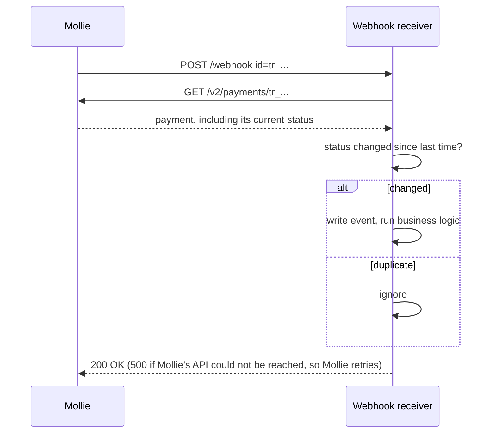

# Mollie webhook receiver

A small Python (Flask) service that receives webhook calls from the [Mollie Payments API](https://docs.mollie.com/reference/webhooks) in **test mode**, looks up the payment, and logs every real status change. It is the missing half of the Postman exercises in [`../mollie-api-postman`](../mollie-api-postman): there I create a payment with a `webhookUrl`, here is the server that answers.

## Why a webhook at all

After a customer pays, the shop has to find out whether the payment succeeded before it ships anything. The redirect back to the shop proves nothing (the customer can close the tab), and polling wastes calls. So Mollie calls a URL of the shop when the status changes.

Three facts from Mollie's documentation shape the design:

- The call contains **only the payment id** (`id=tr_...` as a form field), never the status. A fake call can therefore never make a shop ship an unpaid order: the shop asks Mollie itself.
- Mollie wants `200 OK` within **15 seconds**. Any other answer is retried, up to 10 times over about 26 hours.
- For an unknown id the recommended answer is still `200 OK`, so that nobody can probe which ids exist.



## Design decisions

| Decision | Reason |
|---|---|
| Status always comes from `GET /v2/payments/{id}`, never from the request | The webhook is only a signal. Tested: a `status=paid` field in the body is ignored |
| Only act when the status changed | Mollie may call more than once. Doing "ship the order" twice would be a bug |
| Answer `200` for invalid or unknown ids | Gives nothing away to someone probing the URL, and Mollie stops retrying |
| Answer `500` when the Mollie API cannot be reached | Mollie retries later, so no update is lost |
| Id format is checked before any lookup | Stops junk input from reaching the API call |
| Refuses to start without a `test_` key | The project is test mode only |
| `/events` only answers on the local machine | A tunnel exposes the app to the internet. Tunnels add `X-Forwarded-For`, and the page refuses those requests |
| Events are stored as lines in `events.jsonl` and re-read at start | Duplicates are still recognised after a restart, without needing a database |

## Run it

```bash
python -m venv .venv && source .venv/bin/activate      # Windows: .venv\Scripts\activate
pip install -r requirements.txt
cp .env.example .env                                   # then put YOUR Mollie test key in .env
python app.py                                          # listens on http://localhost:5000
```

Mollie cannot reach `localhost`, so open a tunnel in a second terminal, for example with [ngrok](https://ngrok.com/) (`ngrok http 5000`) or Cloudflare Tunnel. The tunnel shows a public `https://...` address.

**Try it with Postman:**

1. In the Postman environment "Mollie test", set `webhookUrl` to `https://<your-tunnel-address>/webhook`.
2. Run **Create payment with webhook** from the collection and open the checkout link.
3. Choose a status on the test checkout page. Watch the terminal where `app.py` runs: a line appears for the new status.
4. Open `http://localhost:5000/events` to see what was stored.
5. Choose "paid" on a payment that was `open`: you get a second event. Send the same webhook twice with `curl -X POST -d "id=tr_..." http://localhost:5000/webhook`: the second one is logged as a duplicate.

Stop the tunnel when you are done.

## Tests

```bash
pytest
```

The tests run without internet and without a key. A fake replaces the call to Mollie. They cover: a paid webhook is stored, duplicates are ignored, a status change is a new event, a status in the request body is ignored, unknown and invalid ids give 200, an API failure gives 500, state survives a restart, the debug page is blocked behind a tunnel, and a live key is refused.

## Gotchas worth knowing (from Mollie's documentation)

- A webhook URL must be reachable from the internet. `localhost` is rejected.
- If the URL answers with a `301` or `302` redirect, the call turns into a GET and the `id` is lost. Use `307` or `308`.
- A webhook is not called when the customer cancels on the method's own payment page while a `method` was fixed in the request. They are sent back to the checkout to choose another method.
- Subscription payments also trigger the webhook. The payment id is then new to the shop, and the `subscriptionId` field says where it belongs. The receiver logs that field.

## Limits and next steps

- Classic Mollie webhooks are not signed, which is why the receiver always fetches the payment. Mollie also offers next-gen webhooks (beta) with more event types, which I have not tried.
- `events.jsonl` is a demo store. A real shop would use a database and a queue, and would answer within 15 seconds by doing slow work in the background.
- `react()` in `app.py` only logs. The next step is the yoga-studio proof of concept in [`../mollie-yoga-studio-poc`](../mollie-yoga-studio-poc), which does something useful with the status.

Written with the help of an AI assistant.
