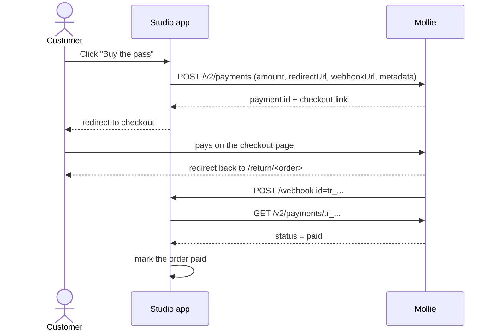
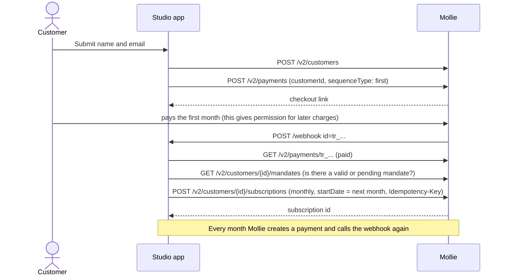

# Lotus Yoga Studio: a Mollie proof of concept

A small Flask app that plays the role of a fictional merchant, a yoga studio, and connects it to the [Mollie](https://docs.mollie.com) test environment. It is a proof of concept of the kind a Solution Engineer builds with a partner: translate a business need into the right API calls, and make the status updates reliable.

**Test mode only.** The code refuses to start with a key that does not start with `test_`. No real money, no real customer data.

## The business need

| The studio wants to... | Mollie building block |
|---|---|
| Sell a 10-class pass, paid once | Payments API: create a payment, redirect to checkout, find out the result |
| Let people become members and be charged every month | Customers, a first payment with `sequenceType: first` (this creates a **mandate**), then a **subscription** |
| Know reliably who has paid | A **webhook**, not the page the customer returns to |
| Never charge a member twice, even if something is retried | **Idempotency keys** and a "claim before you act" step in the code |
| Stop a membership | Cancel the subscription |

## How it works

**A single pass (one-off payment)**



**A membership (first payment, mandate, subscription)**



## Decisions that matter

| Decision | Why |
|---|---|
| The return page asks Mollie for the status and ignores anything in the URL | The browser can be closed, or a URL edited. Tested: a fake `?status=paid` changes nothing |
| The webhook is the source of truth and always fetches the payment | The webhook contains only the id, never the status |
| The subscription is created only after the first payment is `paid` and a mandate exists | A subscription without a mandate fails. If the mandate is not there yet, a later webhook call tries again |
| The subscription starts one month later (`startDate`) | The first month was just paid in the first payment. Month-end is handled (31 January gives 28 or 29 February) |
| The code first **claims** the job in the database (`sub_state = 'creating'`), then calls Mollie | If two webhook calls arrive at once or Mollie repeats a call, only one of them creates the subscription |
| The subscription call also carries an `Idempotency-Key` | If the studio retries after a timeout, Mollie returns the first answer and does not charge twice |
| On a Mollie error the webhook answers `500` and releases the claim | Mollie retries later, and the retry can succeed |
| Unknown or malformed ids get `200 OK` | Gives nothing away to someone probing the URL |
| `/admin` only answers on the local machine | A tunnel makes the app public. Tunnels add `X-Forwarded-For`, and the page refuses those requests |

## Run it

**1. Set up the Mollie test profile.** In the Mollie dashboard, in test mode, enable **Credit card**, **SEPA Direct Debit** and **iDEAL** for your profile. A first payment can only offer methods that can start a mandate, and iDEAL creates a SEPA direct debit mandate, so SEPA Direct Debit has to be on as well. Without it the membership checkout has nothing to offer. You can check with `GET /v2/methods?sequenceType=first`: an empty list means no method can start a mandate (the request "List methods for a first (mandate) payment" in my [Postman collection](../mollie-api-postman) does exactly this).

**2. Start the app.**

```bash
python -m venv .venv && source .venv/bin/activate      # Windows: .venv\Scripts\activate
pip install -r requirements.txt
cp .env.example .env                                   # fill in YOUR test key and, in step 3, PUBLIC_URL
python studio.py                                       # http://localhost:5000
```

**3. Open a tunnel** so that Mollie can reach the webhook, for example `ngrok http 5000`, and put the public `https://...` address in `PUBLIC_URL` in `.env`. Restart the app. Stop the tunnel when you are done.

**4. Try it.** Open `http://localhost:5000`. Buy a pass and complete the test checkout. Become a member: pay the first month on the test checkout, then open `http://localhost:5000/admin` to see the order become `paid` and a subscription id appear. Cancel it there to clean up (test-mode subscriptions also stop by themselves after 10 payments).

## Tests

```bash
pytest
```

18 tests run offline against a fake Mollie: pass flow, input validation, the first payment, one subscription after repeated webhooks, no subscription after a failed payment, a late mandate, a failing subscription call that can be retried, unknown and malformed ids, subscription payments that are new to the shop, the local-only admin page, cancelling, month-end dates and refusing a live key.

## Limits

- SQLite and a Flask development server: fine for a demo, not for production.
- No login, no emails, no real classes. The point is the payment flow.
- Subscription payments are only logged (`payment_log`). A real studio would use them to extend access, and would handle failed monthly payments (Mollie retries up to five times before cancelling).
- Not tried against Mollie's live environment, on purpose.

Written with the help of an AI assistant.
